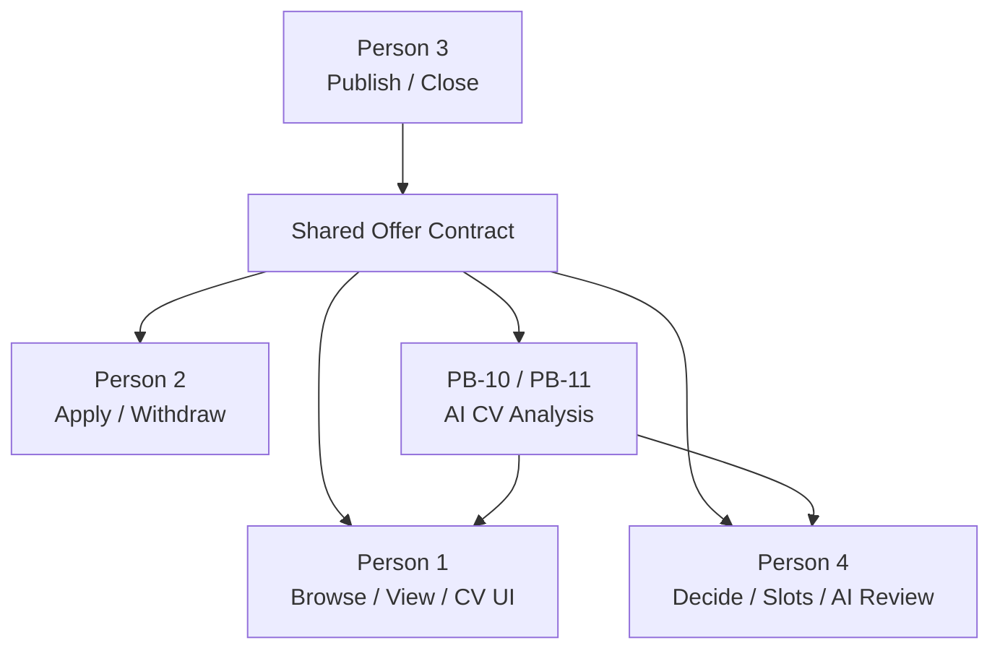
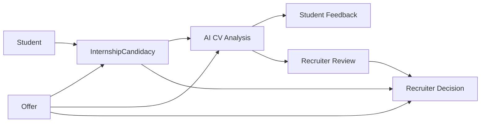
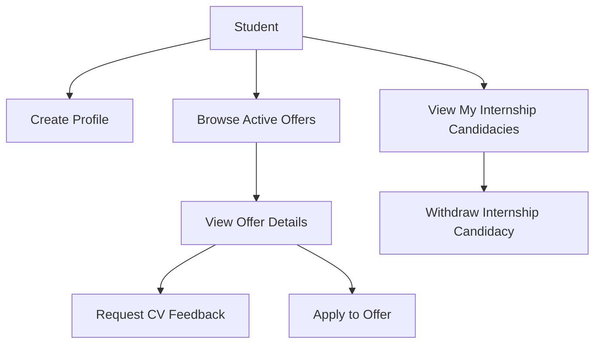
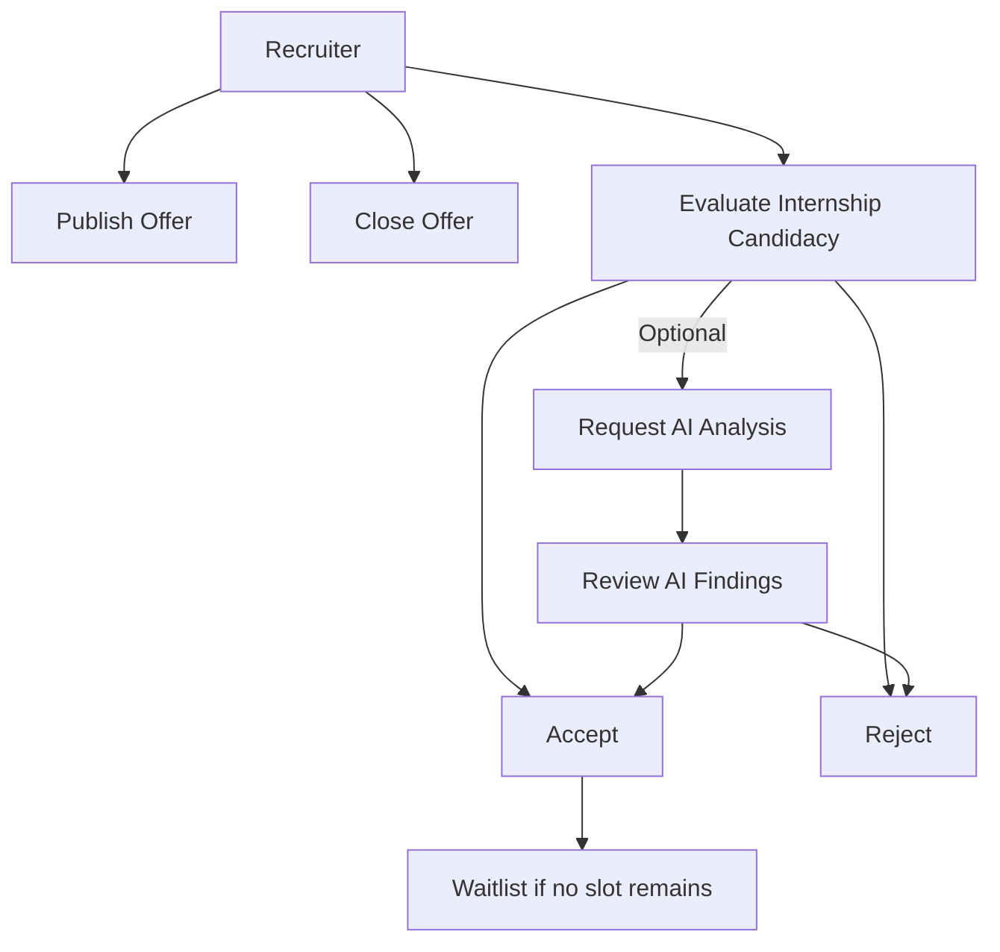
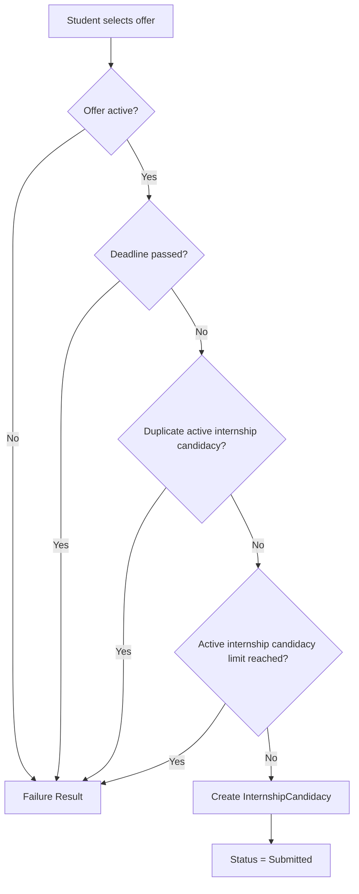
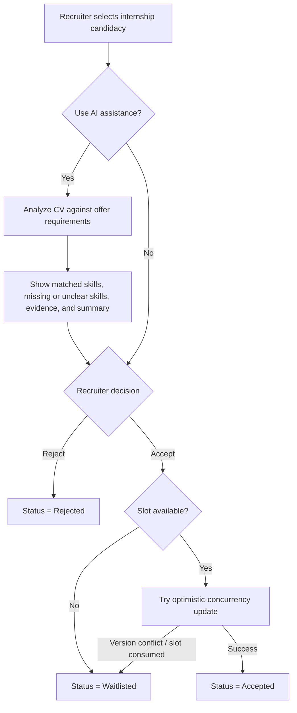

# InternHub

InternHub is a platform for managing internship offers and student internship candidacies. Students can discover internship opportunities, apply to offers, track and withdraw internship candidacies when permitted, and request AI-assisted feedback about how well their CV matches an internship offer. Recruiters can publish and close offers, evaluate internship candidacies, and optionally use AI-assisted CV analysis to support that evaluation.

The AI component is advisory only. It provides CV feedback to students and can also help recruiters evaluate internship candidacies by comparing a candidate's CV with the selected offer requirements. It highlights matched skills, missing or unclear skills, supporting evidence, and a concise summary. The AI does not make the final recruitment decision, automatically accept or reject candidates, or replace recruiter judgment.


## 1. Repository Information

- **Repository name:** `InternHub`
- **Development model:** Scrum
- **Sprint duration:** 1 week
- **Team size:** 4 people - Roberta, Carina, Daria, Ariana
- **Architecture approach:** vertical slices

### Recommended GitHub workflow

1. Keep `main` stable.
2. Create a branch for each feature or technical task.
3. Open a Pull Request before merging.
4. Run automated tests before merge.
5. Require at least one team review for non-trivial changes.
6. Merge only when the applicable Definition of Done criteria are satisfied.

Example branch names:

```text
feature/student-profile
feature/publish-offer
feature/apply-offer
feature/cv-feedback
feature/recruiter-ai-review
feature/decide-internship-candidacy
fix/internship-candidacy-deadline-validation
```
### Running the Project

#### Prerequisites

- .NET SDK 10

#### Build

From the repository root:

```bash
dotnet build
```

#### Run the API

```bash
dotnet run --project ./src/InternHub.Api/InternHub.Api.csproj
```

The API address will be displayed in the terminal after the application starts.

The current implementation uses in-memory repositories, so stored Students and Offers are reset when the application is restarted.

#### Run Tests

```bash
dotnet test ./tests/InternHub.Tests/InternHub.Tests.csproj
```


## 2. Project Goals

InternHub aims to:

- provide students with access to active internship offers;
- allow students to create and manage internship internship candidacies;
- allow recruiters to publish and close internship offers;
- allow recruiters to accept or reject candidates;
- allow recruiters to request AI-assisted analysis of candidate CVs against offer requirements;
- enforce internship candidacy limits, deadlines, slot limits, and other business rules;
- safely handle concurrent decisions for the final available internship slot;
- provide local AI-assisted CV feedback for students;
- provide local AI-assisted internship candidacy review for recruiters;
- keep final recruitment decisions under recruiter control;
- keep CV content private and outside the application database and logs.


## 3. Main Actors

### Student

A student can:

- create a student profile;
- browse active internship offers;
- view offer details;
- apply to an internship offer;
- view submitted internship candidacies;
- withdraw an internship candidacy when the current state allows it;
- request AI-assisted CV feedback for a selected offer.

### Recruiter

A recruiter can:

- publish internship offers;
- define requirements, deadline, and maximum available slots;
- evaluate internship candidacies;
- request AI-assisted analysis for a selected internship candidacy;
- review matched skills, missing or unclear skills, supporting evidence, and an AI-generated summary;
- accept or reject candidates based on their own evaluation;
- manually close an internship offer.

### Local AI Service

InternHub uses a local Ollama-based AI service for CV analysis. The same AI capability supports two user-facing scenarios:

1. student CV feedback before or during the internship candidacy process;
2. recruiter-assisted internship candidacy review.

Input:

```text
CV text
+
Selected offer requirements
```

Student-facing output:

```json
{
  "matchedSkills": [],
  "missingSkills": [],
  "suggestions": []
}
```

Recruiter-facing output:

```json
{
  "matchedSkills": [],
  "missingOrUnclearSkills": [],
  "evidence": [],
  "summary": ""
}
```

For recruiters, the AI analysis is requested on demand for a selected internship candidacy. It helps the recruiter identify how the CV relates to the offer requirements, but it does not change the internship candidacy status automatically.

The final decision always belongs to the recruiter. Only an explicit recruiter action can accept or reject a candidate.


## 4. Product Backlog

The current Product Backlog is organized around functional slices.

| ID | Backlog Item | Main Actor |
|---|---|---|
| PB-01 | Create Student Profile | Student |
| PB-02 | Publish Internship Offer | Recruiter |
| PB-03 | Browse Active Offers | Student |
| PB-04 | View Offer Details | Student |
| PB-05 | Apply to an Offer | Student |
| PB-06 | Withdraw Internship Candidacy | Student |
| PB-07 | Decide Internship Candidacy | Recruiter |
| PB-08 | View My Internship Candidacies | Student |
| PB-09 | Close Internship Offer | Recruiter |
| PB-10 | AI CV Feedback | Student |
| PB-11 | AI-Assisted Internship Candidacy Review | Recruiter |

The backlog is expected to evolve when requirements are clarified or feedback is received.


## 5. Team Organization

The project is developed by **4 team members**. The team uses vertical slices, so nobody is assigned permanently only to frontend, backend, database, AI, or testing.

Each team member is responsible for implementing complete features end-to-end, including the applicable parts of:

- frontend;
- backend / application logic;
- REST APIs;
- persistence;
- business rules;
- validation;
- AI-related work;
- unit tests;
- integration tests;
- integration with other slices;
- documentation.

### Person 1 - Student Profile + Offer Discovery

**Main backlog items**

- PB-01 - Create Student Profile
- PB-03 - Browse Active Offers
- PB-04 - View Offer Details

**Main responsibilities**

- Student Profile UI and backend flow;
- browse active offers;
- view offer details;
- Student persistence;
- student-side integration of CV feedback;
- display `matchedSkills`, `missingSkills`, and `suggestions`;
- ensure CV feedback is independent from internship candidacy submission;
- tests for Student and Offer discovery flows.

**AI responsibility**

Student-facing CV Feedback integration.

**Coordination responsibility**

Shared API contracts and DTO consistency.


### Person 2 - Internship Candidacy Lifecycle

**Main backlog items**

- PB-05 - Apply to an Offer
- PB-06 - Withdraw Internship Candidacy
- PB-08 - View My Internship Candidacies

**Main responsibilities**

- Submit Internship Candidacy;
- View My Internship Candidacies;
- Withdraw Internship Candidacy;
- InternshipCandidacy persistence;
- deadline validation;
- duplicate internship candidacy prevention;
- maximum active-internship-candidacy limit;
- closed-offer validation;
- allowed withdrawal states;
- recruiter notification for a withdrawn `Shortlisted` internship candidacy;
- success/failure handling using `Result<T>`;
- unit and integration tests for internship candidacy rules.

**AI responsibility**

Deterministic Fake `ICvFeedbackProvider` used by automated tests for both student-facing CV feedback and recruiter-facing internship candidacy review.

**Coordination responsibility**

Database migrations and data-integrity conventions.


### Person 3 - Internship Offer Management

**Main backlog items**

- PB-02 - Publish Internship Offer
- PB-09 - Close Internship Offer

**Main responsibilities**

- recruiter UI for publishing offers;
- recruiter UI/action for closing offers;
- Offer API;
- Offer persistence;
- shared Offer contract;
- `IsClosed` handling;
- `Version` configuration for optimistic concurrency;
- integration with Student, InternshipCandidacy, recruiter-decision, and AI flows.

The shared Offer data includes:

```text
Id
Title
CompanyName
Requirements
Deadline
MaximumAvailableSlots
IsClosed
Version
```

**AI responsibility**

Local Ollama provider integration:

- send CV text and Offer requirements to the local model;
- support both student-facing feedback and recruiter-facing internship candidacy analysis;
- validate the structured AI output required by each use case;
- handle invalid responses;
- return a clear failure when the AI service is unavailable;
- ensure the rest of InternHub remains operational when AI fails.

**Coordination responsibility**

Docker / CI / reproducible local development environment.


### Person 4 - Internship Candidacy Evaluation + Slot Management

**Main backlog items**

- PB-07 - Decide Internship Candidacy
- PB-11 - AI-Assisted Internship Candidacy Review

**Main responsibilities**

- recruiter internship-candidacy-evaluation UI;
- on-demand AI analysis action for a selected internship candidacy;
- display recruiter-facing AI results: matched skills, missing or unclear skills, evidence, and summary;
- keep AI analysis separate from the final recruiter decision;
- Accept / Reject actions;
- `Accepted`, `Rejected`, and `Waitlisted` outcomes;
- available-slot enforcement;
- optimistic concurrency;
- simultaneous decisions for the final available slot;
- InternshipCandidacy status updates;
- concurrency and integration testing.

The system must guarantee that the configured slot limit is never exceeded.

When two decisions compete for the final available slot:

```text
Request A ----\
               >---- Offer Version / optimistic concurrency
Request B ----/                   |
                                    +--> one Accepted
                                    +--> one Waitlisted
```

**AI / ML responsibility**

Recruiter-facing AI review and AI model evaluation:

- integrate AI analysis into the recruiter internship-candidacy-review flow;
- prepare synthetic CV-offer test pairs;
- manually label expected skills;
- compare multiple models;
- measure structured-output validity;
- compare AI output with manual labels;
- verify that AI results remain advisory;
- document evaluation results.

**Coordination responsibility**

Testing strategy, security, and quality conventions.


## 6. Collaboration Model

The team follows the rule:

> **Contract first, implementation independently, integration afterwards.**

When two slices depend on the same entity or API:

1. agree on the shared contract;
2. define request/response DTOs;
3. use seeded data, Fake providers, or in-memory implementations where necessary;
4. implement the slices independently;
5. replace temporary implementations with the real dependency;
6. run integration tests before merge.

### Shared contract dependencies



### Shared entities



---

## 7. Main Use Cases

### Student use cases



### Recruiter use cases




## 8. Internship Candidacy Flow

A simplified student internship candidacy flow is:



All business rules are enforced in the backend, not only in the frontend.


## 9. Recruiter AI Review, Decision and Concurrency Flow



AI assistance is optional and never changes an internship candidacy status by itself. The recruiter remains responsible for the final decision.

The Offer `Version` property protects the final available slot from concurrent acceptance.

---

## 10. Proposed Delivery Plan

The team works in **1-week Scrum sprints**.

The exact number of calendar weeks depends on the course deadline. The following sequence describes the planned work until the product is complete; if the available calendar changes, milestones can be split or combined without changing the backlog ownership.

### Sprint 1 - Foundation and Shared Contracts

**Goal:** create a working project foundation and establish the contracts needed for independent development.

**Person 1**

- Student Profile foundation;
- Student DTO/API contract;
- basic Student persistence.

**Person 2**

- InternshipCandidacy entity and persistence foundation;
- define status representation;
- prepare validation/test structure.

**Person 3**

- Offer entity and shared Offer contract;
- PB-02 Publish Internship Offer foundation;
- persistence for Offer;
- initial local-development setup.

**Person 4**

- Recruiter decision contract;
- recruiter AI-review contract;
- slot-management design;
- testing/concurrency test strategy.

**Shared**

- initialize repository structure;
- configure database and migrations;
- agree on API conventions;
- agree on `Result<T>` conventions;
- establish Pull Request workflow;
- establish Definition of Done checks.

**Sprint outcome:** the project builds, core entities/contracts exist, and each member can continue work without waiting for another member's complete implementation.

---

### Sprint 2 - Offer Discovery and Internship Candidacy Submission

**Goal:** complete the first end-to-end student journey from discovering an offer to applying.

**Person 1**

- PB-03 Browse Active Offers;
- PB-04 View Offer Details.

**Person 2**

- PB-05 Apply to an Offer;
- deadline validation;
- duplicate-internship-candidacy validation;
- active-internship-candidacy limit validation.

**Person 3**

- complete PB-02;
- expose Offer information required by Student and InternshipCandidacy slices.

**Person 4**

- recruiter-side evaluation view/API skeleton;
- AI-assisted internship-candidacy-review contract;
- integration contract for InternshipCandidacy decisions.

**Sprint outcome:**

```text
Student -> Browse -> View Offer -> Apply
```

works end-to-end with backend validation and automated tests.

---

### Sprint 3 - Internship Candidacy and Offer Lifecycle

**Goal:** complete the normal internship candidacy-management lifecycle.

**Person 1**

- refine student offer views;
- prepare student-side CV Feedback interaction using the Fake provider.

**Person 2**

- PB-06 Withdraw Internship Candidacy;
- PB-08 View My Internship Candidacies;
- withdrawal validation;
- Shortlisted withdrawal notification.

**Person 3**

- PB-09 Close Internship Offer;
- ensure new internship candidacies are rejected after closure;
- ensure existing internship candidacies remain valid.

**Person 4**

- basic PB-07 Accept / Reject / Waitlist logic;
- InternshipCandidacy status update tests.

**Sprint outcome:** students can manage internship candidacies, recruiters can close offers, and recruiter decisions work in non-concurrent scenarios.


### Sprint 4 - Slot Management, Concurrency and Reliability

**Goal:** complete the most important consistency and concurrency scenarios.

**Person 1**

- student-side failure handling;
- integration tests between Offer discovery and other slices.

**Person 2**

- data-integrity validation;
- deadline and withdrawal edge cases;
- migration/constraint verification.

**Person 3**

- configure Offer `Version` for optimistic concurrency;
- verify persistence behavior;
- start real Ollama-provider integration.

**Person 4**

- complete concurrent PB-07 behavior;
- simultaneous final-slot tests;
- verify that exactly one candidate becomes `Accepted` and the other becomes `Waitlisted`.

**Sprint outcome:** the slot limit remains correct even under simultaneous requests.


### Sprint 5 - AI CV Feedback and Recruiter Internship Candidacy Review

**Goal:** complete PB-10 and PB-11 end-to-end.

**Person 1**

- student CV Feedback UI;
- student-side API integration;
- display `matchedSkills`, `missingSkills`, and `suggestions`.

**Person 2**

- deterministic Fake provider for both AI use cases;
- repeatable automated AI integration tests.

**Person 3**

- shared Ollama provider;
- structured output validation for student and recruiter responses;
- AI-service failure handling;
- privacy checks around CV payloads.

**Person 4**

- recruiter AI-assisted internship-candidacy-review UI;
- on-demand AI analysis action for a selected internship candidacy;
- display `matchedSkills`, `missingOrUnclearSkills`, `evidence`, and `summary`;
- AI/model evaluation;
- synthetic evaluation dataset;
- model comparison;
- evaluation metrics and documentation.

**Shared**

- ensure AI is independent from Apply;
- ensure AI never changes an internship candidacy status automatically;
- ensure final recruitment decisions remain human-controlled;
- ensure CV text is not persisted or logged;
- verify Romanian and English CV/offer analysis.

**Sprint outcome:**

```text
Student -> Offer -> CV Feedback -> Structured AI Result

Recruiter -> InternshipCandidacy -> AI Analysis -> Review Findings -> Human Decision
```

Both flows work with deterministic tests and the local Ollama implementation.


### Sprint 6 - Integration, Hardening and Final Delivery

**Goal:** make the complete system ready for final review/demo.

**All team members**

- resolve remaining integration issues;
- run full unit/integration test suite;
- execute concurrency tests;
- verify privacy and role separation;
- validate all Product Backlog acceptance criteria;
- fix regressions;
- update endpoint documentation;
- update setup instructions;
- update diagrams;
- complete README;
- prepare final demonstration.

**Sprint outcome:** all implemented stories satisfy the applicable Definition of Done criteria and the complete application is demonstrable from a clean setup.


## 12. Definition of Done

A user story is considered **Done** only when all applicable criteria are satisfied.

### Functionality

- all acceptance criteria are implemented and verified;
- relevant business rules are enforced;
- input validation and error handling are implemented;
- expected outcomes use success/failure `Result<T>`;
- existing functionality is not broken.

### Code and architecture

- code follows the agreed vertical-slice structure;
- business rules are not implemented only in the UI;
- external dependencies are accessed through abstractions where applicable;
- shared contracts remain consistent.

### Testing

- relevant unit tests exist;
- persistence interactions have integration tests where applicable;
- both success and failure scenarios are tested;
- time-dependent logic is deterministic;
- concurrency behavior is tested where applicable;
- all automated tests pass.

### AI and privacy

- AI feedback remains advisory for both students and recruiters;
- recruiter-facing AI analysis compares the candidate CV with the selected offer requirements;
- recruiter-facing output exposes matched skills, missing or unclear skills, evidence, and a concise summary;
- AI never accepts, rejects, waitlists, or otherwise changes an internship candidacy status automatically;
- final recruitment decisions require an explicit recruiter action;
- automated tests do not depend on live Ollama;
- raw CV text is not stored in the application database;
- raw CV text is not written to logs or error messages;
- AI-service failure does not break standard application functionality.

### Delivery

- endpoints and request/response formats are documented;
- the application builds successfully;
- changes are reviewed before merge.


## 13. Open Requirements

The team must **not hard-code assumptions** for requirements that are still unclear.

The following points require clarification:

- how recruiters are represented and authenticated;
- which internship candidacy statuses count as active;
- how the waiting list is ordered;
- whether an `Accepted` candidate may withdraw and free a slot;
- whether a closed offer can be reopened;
- the exact expected behavior when local Ollama is unavailable.

These decisions will be updated in the requirements, backlog, tests, and README once clarified.


## 14. Suggested Repository Structure

```text
InternHub/
│
├── README.md
├── src/
│   ├── Student/
│   ├── Offers/
│   ├── InternshipCandidacies/
│   ├── Decisions/
│   ├── CvFeedback/
│   └── RecruiterAiReview/
│
├── tests/
│   ├── Unit/
│   ├── Integration/
│   └── Concurrency/
│
├── docs/
│   ├── engineering-requirements/
│   ├── product-backlog/
│   ├── definition-of-done/
│   ├── team-responsibilities/
│   └── diagrams/
│
└── docker/
```

The exact source-tree structure may be adjusted to the final application architecture. The important rule is to keep feature ownership and vertical slices clear.


## 15. Project Completion Criteria

The project is ready for final delivery when:

- all agreed MVP Product Backlog Items are implemented;
- acceptance criteria are satisfied;
- critical business rules are covered by tests;
- optimistic concurrency prevents slot overbooking;
- student AI feedback works locally;
- recruiter AI-assisted internship candidacy review works locally;
- AI does not make or automatically execute recruitment decisions;
- final recruitment decisions remain under recruiter control;
- no raw CV content is persisted or logged;
- the complete automated test suite passes;
- the project builds from a clean environment;
- documentation is up to date;
- the repository remains private and the required reviewer/collaborator has access.


## 16. Current Planning Summary

```text
Requirements
    |
    v
Product Backlog
    |
    v
1-week Sprint Planning
    |
    v
Vertical Slices
    |
    +--> Frontend
    +--> Backend / API
    +--> Persistence
    +--> Business Rules
    +--> AI integration where applicable
    +--> Unit / Integration Tests
    |
    v
Definition of Done
    |
    v
Integrated Increment
```

The core team rule is:

> **Each person owns a complete functional area, one defined AI/ML responsibility, and one coordination responsibility, while all four members develop end-to-end vertical slices and integrate through shared contracts.**
